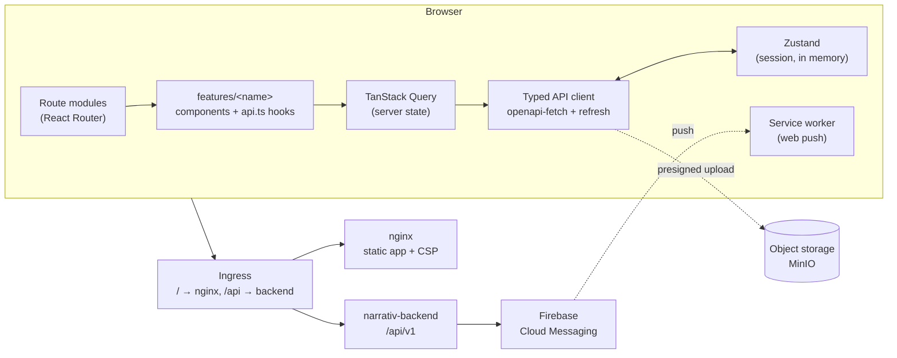

# NARRATIV Web Client

The web version of NARRATIV for users (role `USER`): the same social storytelling app as the Android client, in the
browser. The admin panel (`narrativ-web-admin`) and the public website (`narrativ-web-landing`) are separate, private
projects.

> The source is public for review only. It is not open source: see [LICENSE](LICENSE).

**Related repositories:** [narrativ-backend](https://github.com/rizkysiregar/narrativ-backend) (the REST API this
client talks to), [narrativ-android](https://github.com/rizkysiregar/narrativ-android) (the native Android client) and
[narrativ-media-worker](https://github.com/rizkysiregar/narrativ-media-worker) (video thumbnails).

The development plan, its phases and their progress live in [docs/PLAN.md](docs/PLAN.md) (in Indonesian).

## Features

- **Account:** sign in with username and password or with Google, register with an email OTP, reset a forgotten password, edit the
  profile and profile picture, change email (OTP plus current password or Google), delete the account.
- **Feed:** home feed (your posts and the people you follow, then suggestions) and Explore, with cursor paging.
- **Posts:** create a post with a caption and photos or videos, checked against the backend's limits before
  uploading. Files go straight from the browser to object storage with presigned forms. Open a post on its own page
  and share its link.
- **Conversation:** comments with threaded replies; the author can pin one comment, and a reader can select part of
  the caption to quote it in a comment.
- **People:** profiles with posts and media tabs, followers and following lists, user search.
- **Notifications:** an inbox grouped by event with an unread badge, and web push through Firebase Cloud Messaging
  (a service worker shows pushes while the tab is closed).
- **Safety:** block and unblock users, manage blocked accounts, report posts, comments and users.
- **Languages:** Indonesian and English, sent to the backend so its messages match.

## Tech stack

| Area         | Technology                                                               |
| ------------ | ------------------------------------------------------------------------ |
| Runtime      | Node 24 LTS (`.tool-versions`)                                           |
| Framework    | React 19, React Router 8 (framework mode, SPA for now), Vite 8           |
| Language     | TypeScript 6, strict                                                     |
| API          | `openapi-fetch` with types generated from the backend's OpenAPI document |
| Server state | TanStack Query 5                                                         |
| Client state | Zustand (session only)                                                   |
| Styling      | Tailwind CSS 4, the app's dark palette and Bricolage Grotesque           |
| i18n         | i18next (Indonesian, English)                                            |
| Tests        | Vitest, Testing Library, MSW; Playwright smoke tests against dev         |
| Monitoring   | Sentry (errors only, loaded after start-up, no personal data)            |
| Quality      | ESLint (typescript-eslint strict), Prettier, Husky + lint-staged         |
| Delivery     | nginx image, Jenkins, Argo CD (from a private GitOps repository)         |

## Getting started

```bash
asdf install            # Node 24 from .tool-versions (or any Node >= 24.11)
npm install
npm run dev             # http://localhost:3000, /api proxied to the dev backend
```

`.env.example` lists the optional settings (another backend, another port). Copy it to `.env.local`.

| Script                 | What it does                                                                     |
| ---------------------- | -------------------------------------------------------------------------------- |
| `npm run dev`          | Dev server with hot reload                                                       |
| `npm run build`        | Production build to `build/client` plus `build/nginx` (CSP header)               |
| `npm run verify`       | Prettier check, ESLint, typecheck and unit tests (what CI runs)                  |
| `npm test`             | Unit tests once (`test:watch` to keep them running)                              |
| `npm run api:generate` | Regenerates `app/api/schema.d.ts` from the dev backend's OpenAPI                 |
| `npm run api:check`    | Fails when `schema.d.ts` differs from what the backend serves                    |
| `npm run e2e`          | Playwright smoke tests against dev, run by hand (`E2E_USERNAME`, `E2E_PASSWORD`) |

## Architecture



- **One origin.** The page and the API share a host: the ingress sends `/api` to the backend and everything else to
  the nginx image, so there is no CORS and the same image runs in every environment.
- **Data flow.** Route modules stay thin; each feature owns its components and the TanStack Query hooks in its
  `api.ts`, which call the typed client. Server data lives only in the query cache, and Zustand holds just the
  session.
- **Types from the backend.** The client's types are generated from the backend's OpenAPI document, and CI marks
  the build unstable when the backend's contract has moved on.

## How it talks to the backend

- **Same origin.** The API is always called at `/api/v1` on the app's own host: the ingress routes `/api` to the
  backend (and the dev server proxies it in development). No CORS, and one image runs in every environment.
- **Typed client.** `app/api/client.ts` is generated from the backend's OpenAPI document. Wrap calls in `request()`
  to get the `data` of the backend's `{code, message, data}` envelope or an `ApiError`:

  ```ts
  const me = await request(api.GET("/users/me"));
  ```

  After a backend change: `npm run api:generate` and commit `app/api/schema.d.ts`.

- **Session.** The access token lives in memory only. The refresh token is an HttpOnly cookie the backend sets for
  `X-Client-Platform: web`, so scripts never see it. On a 401 the client refreshes once (shared by concurrent calls
  and serialized across tabs with a Web Lock, because the backend rotates the refresh token) and repeats the call.
- Every call sends `X-Client-Platform: web`, `X-App-Version` and `Accept-Language`, so the backend answers in the
  user's language.

## Project structure

```
app/
  root.tsx              document, providers, error boundary, start-up screen
  routes.ts             route table; routes/ holds thin route modules
  api/                  generated schema, typed client, session and refresh, errors
  features/<name>/      one folder per feature (auth, feed, post, ...): api.ts hooks, components, schemas
  shared/               config, i18n, layout, ui primitives, hooks, lib
scripts/                OpenAPI type generation, CSP header generation
nginx/                  server config of the image
```

Rules: components never call `fetch` or the client directly but use the hooks in `features/<name>/api.ts`; server
data stays in TanStack Query and is not copied into Zustand; a feature does not import another feature's internals
(what both need moves to `shared/`).

## Deployment

Every push to `main` runs the `Jenkinsfile`: verify, API contract check (marks the build unstable when the backend
moved on), build, image `ghcr.io/rizkysiregar/narrativ-web-client:<sha>`, and a commit of the new tag to
the private GitOps repository (`apps/narrativ-web-client-dev`), which Argo CD syncs to the dev environment. `/version.json`
tells which build an environment serves. Production (`apps/narrativ-web-client`) is promoted by hand with a tag that
has run well in dev. The Playwright smoke tests (`npm run e2e`) are run by hand when wanted, not by the pipeline.

The build reports errors to Sentry when the `Jenkinsfile` has a DSN: the environment follows the host, the release is
the commit, and source maps are uploaded (credential `sentry-auth-token`) and then deleted from the image.

The image is nginx serving `build/client` with an SPA fallback, `/healthz` for the probes and security headers. The
Content-Security-Policy allows React Router's inline start-up scripts by their SHA-256 hash, computed at build time
by `scripts/csp.mjs`, so scripts need no `'unsafe-inline'`.

## Security notes

- **No secrets in the bundle.** Only `VITE_*` variables reach the browser, and none of them is a secret. The Firebase
  web configuration is public by design and comes from the backend at runtime (`GET /devices/web-push-config`).
- **Tokens out of reach of scripts.** The access token is kept in memory only, never in `localStorage`. The refresh
  token is an HttpOnly, `SameSite=Strict` cookie that page scripts cannot read, and it is rotated on every refresh.
- **Strict Content-Security-Policy.** Inline scripts are allowed only by their SHA-256 hash, computed at build time,
  so there is no `'unsafe-inline'`. Framing is refused (`frame-ancestors 'none'`, `X-Frame-Options: DENY`), with
  `nosniff`, a strict referrer policy and a Permissions-Policy that turns off camera, microphone and geolocation.
- **Validated input.** Forms are validated on the client with schemas, and the backend validates everything again.

## License

Copyright (c) 2026 Habib Rizky Almajid Siregar. All rights reserved. The code is public for review only; see
[LICENSE](LICENSE).
